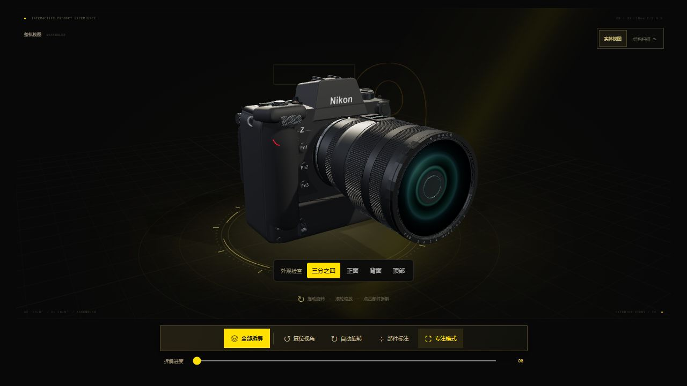

# Nikon Z9 · UNSTOPPABLE

黄黑旗舰主题的可交互产品网页。使用 Three.js 程序化构建相机、镜头与 12 个结构组件，支持拆解、结构扫描和 20 秒实时产品演绎。



## 直接使用

- **离线单文件**：[offline/Nikon-Z9.html](offline/Nikon-Z9.html)。下载后使用 Chrome 或 Edge 打开，无需 API Key、安装依赖或联网。
- **离线压缩包**：[Nikon-Z9-yellow-black-offline.zip](Nikon-Z9-yellow-black-offline.zip)。
- **在线网站**：[打开 Nikon Z9 交互网页](https://mannixsc.github.io/nikon-z9-interactive/)，由 GitHub Pages 托管。

浏览器需启用硬件加速。此网页不发送用户数据，不含统计脚本或付费服务。

## 交互

| 操作 | 效果 |
| --- | --- |
| 拖动 / 滚轮 | 旋转 / 缩放模型 |
| 点击模型或部件目录 | 选择并展开部件，再次点击可收回 |
| 全部拆解 / 进度滑块 | 控制 12 个部件的展开状态 |
| 实体视图 / 结构扫描 | 切换实体材质与半透明线框 |
| 播放产品演绎 | 整机、镜头分离、结构扫描、整机收回，约 20 秒 |
| 下方产品亮点 | 联动对应的结构组件 |

快捷键：`E` 拆解，`R` 复位，`A` 自动旋转，`L` 标注，`X` 扫描，`?` 指南，`Esc` 停止演绎或退出专注模式。支持触屏单指旋转、双指缩放。

## 本地开发

使用 Node.js 和 npm：

```sh
npm install
npm run build
npm start
```

打开 `http://127.0.0.1:4173`。只浏览现成页面时，无需安装依赖，直接执行 `node server.cjs` 即可。

修改页面或源代码后，生成离线单文件：

```sh
npm run build
node make-offline.mjs
```

打包使用 esbuild 0.25.10。Three.js 0.180.0 与 OrbitControls 已保存在 `dist/vendor/`，运行时不加载 CDN。

## 文件结构

```text
src/app.js             三维建模、材质、拆解和产品演绎
dist/index.html        网页结构
dist/style.css         黄黑主题与响应式布局
dist/bundle.js         可直接运行的浏览器打包文件
dist/vendor/           Three.js、OrbitControls 和第三方许可证
offline/               可直接打开的单个 HTML 与使用说明
docs/preview.png       实际浏览器截图
make-offline.mjs       离线单文件生成器
server.cjs             仅监听本机的静态预览服务器
QA.md                  已完成的验证及限制
```

## 参考与模型边界

视觉参考：[尼康 Z9 官网](https://www.nikonusa.com/p/z-9/1669/overview)及 [Nikon Europe 官方发布影片](https://www.youtube.com/watch?v=4MR5p-dH2uc)的开场。没有复制或嵌入原影片素材；页面中的 20 秒演绎由本地三维场景实时生成。

模型是外观与结构示意，不是官方 CAD、精确拆机模型或维修说明。内部骨架、电路、触点、部件数量与拆解顺序均经过简化；镜头为通用 Z 卡口造型，不对应具体镜头型号。结构扫描不代表真实 X 光或测量结果。

产品规格来源：[尼康官方参考指南](https://onlinemanual.nikonimglib.com/z9/en/specifications_348.html)。8.3K 60p 内录适用于 N-RAW，固件 2.0 起提供，见[官方固件公告](https://www.nikonusa.com/press-room/z-9-firmware)。核对日期：2026-10-20。

本项目独立制作，非尼康官方页面。Nikon、Z9、NIKKOR 等名称和标识属于相应权利人。Three.js 和 OrbitControls 使用 MIT 许可证，见 [第三方许可证](dist/vendor/LICENSE.txt)。

## GitHub Pages 发布

在仓库 Settings → Pages 中选择 Deploy from a branch、main 分支与 /(root)，保存即可。根目录 index.html 会跳转到 dist/。更新 dist/ 后将自动重新发布；离线包可作为独立备份。
